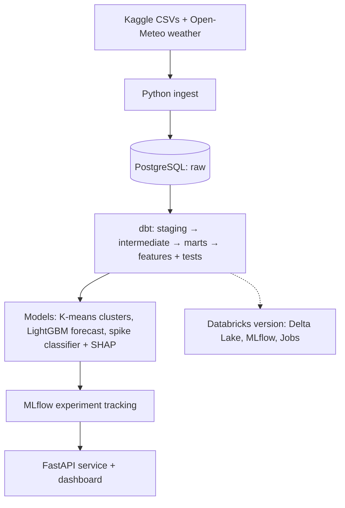

# Shelfcast

**Grocery demand forecasting and replenishment system** built on 125 million rows of real supermarket sales.

Shelfcast predicts how many units of each product each store will sell over the next 14 days, recommends order quantities, explains unusual demand, and tracks forecast accuracy over time.

> **Status:** in progress. Data engineering done: a tested dbt warehouse (18 models, 49 data tests). Next: exploratory analysis, then forecasting. Results will appear here as they are produced.

**Data engineering highlights**

- **ELT pipeline:** 125,497,040 sales rows loaded into PostgreSQL with `COPY`. Every row count is checked against the profiling results.
- **Tested dbt warehouse:** 18 models in staging, intermediate and marts layers, with 49 data tests (keys, relationships, custom checks and a reconciliation test).
- **Data quality, documented:** 24 data issues found, each with its evidence, impact and handling in [data_issues.md](docs/data_issues.md).
- **Second data source from APIs:** 22 store cities geocoded and daily weather loaded, with checks. One geocoding error passed every automatic check and was caught by a manual review.
- **Two platforms:** the raw data is also loaded into Databricks straight from Kaggle ([notebook](databricks/01_load_raw_favorita.ipynb)). The same dbt project connects to PostgreSQL and Databricks, and the source tests pass on both.

---

## Why

Supermarkets lose money in both directions: too little stock means empty shelves and lost sales, too much means waste, especially for perishable food. Shelfcast turns daily sales history, holidays, promotions, oil prices and weather into forecasts a store can order from.

## Data

| Source | What | Size |
|---|---|---|
| [Corporación Favorita (Kaggle)](https://www.kaggle.com/competitions/favorita-grocery-sales-forecasting/data) | Daily item sales for 54 stores in Ecuador, 2013-01-01 to 2017-08-15, plus stores, items, transactions, holidays and oil prices | 125M sales rows |
| [Open-Meteo](https://open-meteo.com/) historical weather (ERA5) | Daily max/min temperature and precipitation for the 22 store cities, 2013-01-01 to 2017-08-15 | 37,136 rows |

The raw data is not included in this repo (size and licence). See [Getting started](#getting-started) to download it.

Weather data by [Open-Meteo.com](https://open-meteo.com/) ([CC BY 4.0](https://creativecommons.org/licenses/by/4.0/)), based on ERA5 from the Copernicus Climate Change Service. City coordinates from the Open-Meteo Geocoding API (GeoNames).

## Architecture



| Layer | Tools |
|---|---|
| Ingestion | Python, pandas, psycopg2 (PostgreSQL `COPY`), requests (Open-Meteo APIs) |
| Warehouse | PostgreSQL, dbt Core (with data tests and docs) |
| Modelling | scikit-learn (K-means), LightGBM, SHAP |
| Tracking | MLflow |
| Serving | FastAPI, Jinja2, Chart.js |
| Production | Docker, GitHub Actions, Databricks (Delta Lake, Jobs) |

## Warehouse

The dbt project in `shelfcast_dbt/` turns the raw tables into a tested warehouse. It follows the medallion pattern: raw is bronze, staging and intermediate are silver, marts are gold.

| Layer | PostgreSQL schema | What it does |
|---|---|---|
| Sources | `raw` | Untouched copies of the CSVs and weather tables, loaded by `scripts/` |
| Staging | `analytics_staging` | One view per source: renames and type fixes only |
| Intermediate | `analytics_intermediate` | Shared logic used by more than one mart (holidays) |
| Marts | `analytics_marts` | The tables everything downstream reads |

The marts are several fact tables at different grains that share the same dimensions:

```
                      dim_item
                         │
dim_store ────────── fct_sales ────────── dim_date
   │  │            (125M rows)               │
   │  └── fct_transactions              fct_oil_daily
   ├───── fct_weather_daily (via city)
   └───── dim_place_holidays (via city / state)
```

| Table | Grain | Holds |
|---|---|---|
| `fct_sales` | store × item × day | Units sold and promotion flag, exactly as recorded |
| `fct_sales_daily_store_family` | store × family × day | Daily totals per product family, a summary of `fct_sales` (2.06M rows) with a reconciliation test |
| `fct_transactions` | store × day | Receipts per store |
| `fct_oil_daily` | day | Oil price, last known price carried over weekends |
| `fct_weather_daily` | city × day | Max/min temperature and precipitation |
| `dim_date` | day | Calendar, paydays, national holidays (only things known in advance) |
| `dim_store` | store | City, province, type, coordinates |
| `dim_item` | item | Family, class, perishable |
| `dim_place_holidays` | date × place | Regional and local holidays |

Every table has a primary-key test, and every fact key is tested against its dimension. Holiday rows are squashed to one per date and place before any join, so joins can't duplicate sales. The marts record what happened (returns, gaps, outliers included); forecast-specific cleaning happens later in a features layer. Column details are in the [data dictionary](docs/data_dictionary.md#warehouse-dbt-marts).

## Results

*Coming next:* forecast accuracy (WAPE and MAE) against a seasonal-naive baseline, per-family accuracy, spike-classifier precision and recall, and a link to the live demo.

## Progress

- [x] Project setup (uv, Python 3.12)
- [x] Profiling of all six raw files ([notebook](notebooks/01_profiling.ipynb), [data dictionary](docs/data_dictionary.md))
- [x] Raw data loaded into PostgreSQL (125,497,040 sales rows, all counts checked against profiling)
- [x] City coordinates and historical weather for 22 cities
- [x] dbt warehouse: staging, intermediate and marts with 49 data tests and docs (also connected to Databricks)
- [x] Raw data loaded into Databricks straight from Kaggle, row counts checked against PostgreSQL ([notebook](databricks/01_load_raw_favorita.ipynb))
- [ ] Exploratory analysis
- [ ] Baseline and LightGBM forecast, tracked in MLflow
- [ ] Product clustering, spike classifier with SHAP, order quantities
- [ ] FastAPI service and monitoring dashboard
- [ ] Full dbt warehouse on Databricks, Docker, CI, live demo

## Repo layout

```
shelfcast/
├── data/raw/            # Kaggle CSVs (not in git)
├── databricks/          # notebooks that run on Databricks
│   └── 01_load_raw_favorita.ipynb   # Kaggle files into Databricks tables
├── docs/
│   ├── data_dictionary.md   # what every column means, and where that comes from
│   └── data_issues.md       # data-quality problems and how each is handled
├── notebooks/
│   └── 01_profiling.ipynb   # first look at every raw file
├── scripts/             # load the raw data and build the weather tables
├── shelfcast_dbt/       # dbt project
│   ├── models/staging/      # one view per raw table + sources.yml (source tests)
│   ├── models/intermediate/ # shared logic (holidays)
│   ├── models/marts/        # fact and dimension tables + marts.yml (model tests)
│   ├── tests/               # custom tests on the raw data
│   └── profiles.yml         # connections (PostgreSQL and Databricks), secrets read from .env
├── sql/                 # checks run after each load (kept for reference; they now also run as dbt tests)
├── src/shelfcast/       # reusable Python code (ingestion, later more)
├── pyproject.toml
└── uv.lock
```

## Getting started

**Prerequisites:** Python 3.12, [uv](https://docs.astral.sh/uv/), PostgreSQL.

1. **Install dependencies**
   ```bash
   uv sync
   ```
2. **Download the data.** On the [Kaggle data page](https://www.kaggle.com/competitions/favorita-grocery-sales-forecasting/data), accept the competition rules, download the files and extract these CSVs into `data/raw/`:
   `train.csv`, `items.csv`, `stores.csv`, `transactions.csv`, `oil.csv`, `holidays_events.csv`
3. **Database.** Create a PostgreSQL database called `shelfcast` with a schema called `raw`. Copy `.env.example` to `.env` and fill in your connection details (`.env` is never committed).
4. **Load the data** (run from the repo root, in this order):
   ```bash
   uv run python scripts/test_connection.py   # checks the database connection
   uv run python scripts/load_raw.py          # stores, items, oil, holidays_events, transactions
   uv run python scripts/load_train.py        # train (125M rows, uses PostgreSQL COPY)
   uv run python scripts/geocode_cities.py    # coordinates for the 22 store cities
   uv run python scripts/load_weather.py      # daily weather for those cities (takes about 4 minutes)
   ```
   The checks in `sql/raw_checks.sql` and `sql/weather_checks.sql` list the expected results.
5. **Build and test the warehouse** (run from inside `shelfcast_dbt/`; dbt reads the connection details from `.env`):
   ```bash
   uv run --env-file ../.env dbt deps      # installs dbt_utils
   uv run --env-file ../.env dbt build     # builds every model and runs every test (fct_sales takes about 20 minutes)
   uv run --env-file ../.env dbt docs generate
   uv run --env-file ../.env dbt docs serve   # model documentation and lineage graph in the browser
   ```
   After the first build, `dbt build --exclude fct_sales` rebuilds everything except the 125M-row table.
   For the Databricks version, fill in the `DATABRICKS_*` values in `.env` and add `--target databricks`.
6. **Databricks (optional).** Import `databricks/01_load_raw_favorita.ipynb` into a Databricks workspace and run it. It needs your own Kaggle API token: paste it only while the cell runs, and never commit it.

## Documentation

- [Data dictionary](docs/data_dictionary.md): every column, labelled Official (Kaggle), Observed (our checks) or Unknown
- [Data issues](docs/data_issues.md): every data problem found and how it is handled

## Author

Mahdhi Shafraz, Data Science undergraduate, SLIIT. [LinkedIn](https://www.linkedin.com/in/mahdhi-shafraz/)

Every design decision and data issue is documented in this repo.