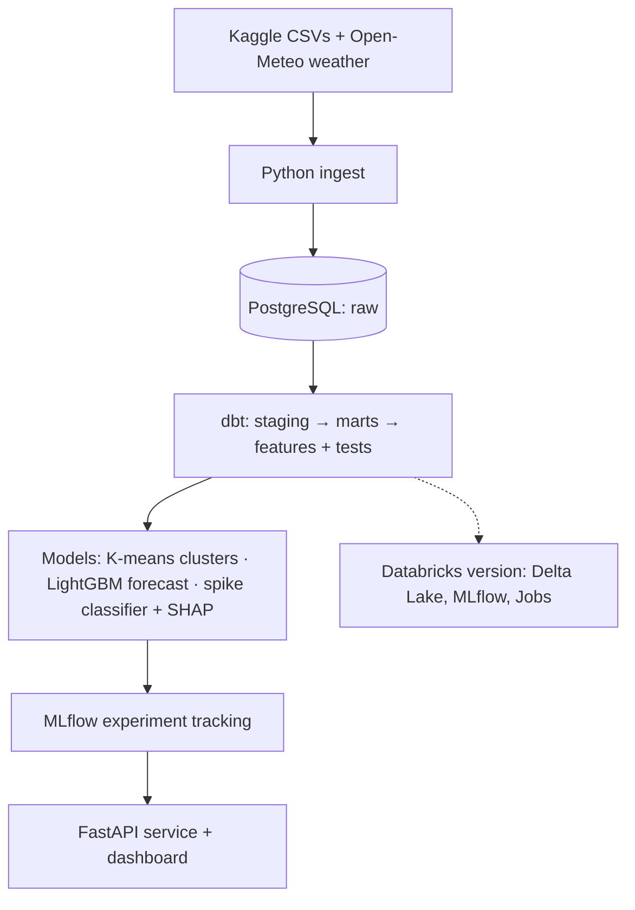

# Shelfcast

**Grocery demand forecasting and replenishment system** built on 125 million rows of real supermarket sales.

Shelfcast predicts how many units of each product each store will sell over the next 14 days, recommends order quantities, explains unusual demand, and tracks forecast accuracy over time.

> **Status:** in progress (week 1 of 3: data engineering). Results will appear here as they are produced.

---

## Why

Supermarkets lose money in both directions: too little stock means empty shelves and lost sales, too much means waste, especially for perishable food. Shelfcast turns daily sales history, holidays, promotions, oil prices and weather into forecasts a store can order from.

## Data

| Source | What | Size |
|---|---|---|
| [Corporación Favorita (Kaggle)](https://www.kaggle.com/competitions/favorita-grocery-sales-forecasting/data) | Daily item sales for 54 stores in Ecuador, 2013-01-01 to 2017-08-15, plus stores, items, transactions, holidays and oil prices | 125M sales rows |
| [Open-Meteo](https://open-meteo.com/) historical weather | Daily weather for the 22 store cities | (planned) |

The raw data is not included in this repo (size and licence). See [Getting started](#getting-started) to download it.

## Architecture



| Layer | Tools |
|---|---|
| Ingestion | Python, pandas |
| Warehouse | PostgreSQL, dbt Core (with data tests and docs) |
| Modelling | scikit-learn (K-means), LightGBM, SHAP |
| Tracking | MLflow |
| Serving | FastAPI, Jinja2, Chart.js |
| Production | Docker, GitHub Actions, Databricks (Delta Lake, Jobs) |

## Results

*Coming in weeks 2 and 3:* forecast accuracy (WAPE and MAE) against a seasonal-naive baseline, per-family accuracy, spike-classifier precision and recall, and a link to the live demo.

## Progress

- [x] Project setup (uv, Python 3.12)
- [x] Profiling of all six raw files ([notebook](notebooks/01_profiling.ipynb), [data dictionary](docs/data_dictionary.md))
- [ ] Raw data loaded into PostgreSQL *(in progress)*
- [ ] Historical weather for 22 cities
- [ ] dbt warehouse with tests and docs
- [ ] Exploratory analysis
- [ ] Baseline and LightGBM forecast, tracked in MLflow
- [ ] Product clustering, spike classifier with SHAP, order quantities
- [ ] FastAPI service and monitoring dashboard
- [ ] Databricks version, Docker, CI, live demo

## Repo layout

```
shelfcast/
├── data/raw/            # Kaggle CSVs (not in git)
├── docs/
│   ├── data_dictionary.md   # what every column means, and where that comes from
│   └── data_issues.md       # data-quality problems and how each is handled
├── notebooks/
│   └── 01_profiling.ipynb   # first look at every raw file
├── src/shelfcast/       # reusable Python code (ingestion, later more)
├── pyproject.toml
└── uv.lock
```

## Getting started

**Prerequisites:** Python 3.12, [uv](https://docs.astral.sh/uv/), PostgreSQL.

1. **Install dependencies**
   ```bash
   uv sync
   ```
2. **Download the data.** On the [Kaggle data page](https://www.kaggle.com/competitions/favorita-grocery-sales-forecasting/data), accept the competition rules, download the files and extract these CSVs into `data/raw/`:
   `train.csv`, `items.csv`, `stores.csv`, `transactions.csv`, `oil.csv`, `holidays_events.csv`
3. **Database.** Create a PostgreSQL database called `shelfcast` and put your connection details in a `.env` file (never committed). Loading instructions will be added once the ingestion scripts are finished.

## Documentation

- [Data dictionary](docs/data_dictionary.md): every column, labelled Official (Kaggle), Observed (our checks) or Unknown
- [Data issues](docs/data_issues.md): every data problem found and how it is handled

## Author

Mahdhi Shafraz, Data Science undergraduate, SLIIT